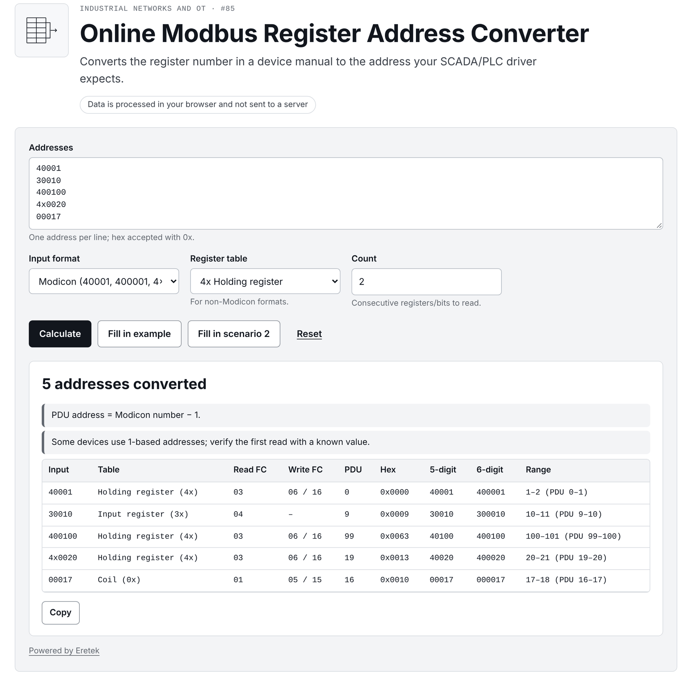

# Modbus Register Address Converter

Convert between Modicon notation (40001, 400001, 4x0001) and the 0-based Modbus PDU address; register table, read/write function codes and hex address.

## Try it live

- [Türkçe](https://endustriyel.eretek.com/araclar/modbus-register-adres-donusturucu)
- [English](https://endustriyel.eretek.com/en/tools/modbus-register-address-converter)
- [Deutsch](https://endustriyel.eretek.com/de/werkzeuge/modbus-registeradressen)



## What it does

Converts the register number in a device manual to the address your SCADA/PLC driver expects.

One manual says 'holding register 40001', another '0x0000', the SCADA driver wants '400001'; all are the same register. An off-by-one error reads the wrong value or, worse, writes the wrong register. The tool converts each notation to table, function code and 0-based PDU address.

## Where it helps

On first read check a known value (e.g. device serial or a constant parameter); if it is shifted by one register there is a 0/1-base mismatch.

## How to use it

1. Enter addresses one per line and choose the format: Modicon (40001/400001/4x0001), 0-based PDU or 1-based register number.
2. For PDU/1-based formats choose the register table; enter a count for consecutive reads.
3. Press Run.

### Fields

| Field | Description |
|---|---|
| Addresses | One address per line; hex accepted with 0x. |
| Input format |  |
| Register table | For non-Modicon formats. |
| Count | Consecutive registers/bits to read. |

## Example input

Press **Fill in example** in the tool to load this input.

| Input | Value |
|---|---|
| Input format | `Modicon (40001, 400001, 4x0001)` |
| Register table | `4x Holding register` |
| Count | `2` |

**Addresses**

```text
40001
30010
400100
4x0020
00017
```

**Expected result:** 40001 → holding register, FC03, PDU 0 (0x0000), 400001; 30010 → input register FC04, PDU 9; 400100 → PDU 99; 4x0020 → PDU 19; 00017 → coil FC01, PDU 16.

## Method and assumptions

Modicon: the first digit is the table (0 coil, 1 discrete input, 3 input register, 4 holding register), the rest the 1-based register; PDU = number − 1. 5-digit notation covers 1–9999 only, 6-digit 1–65536.

Function codes: read 01/02/04/03; write 05/15 for coils, 06/16 for holding registers.

## Limits and common mistakes

- Vendor-specific notations (%MW, N7:0, HR100 etc.) and register map validation are not supported.

## Run it locally

The tool is plain HTML, CSS and JavaScript with no build step and no dependencies.

```bash
git clone https://github.com/eretek/modbus-register-address-converter.git
cd modbus-register-address-converter
node scripts/serve.js        # or: python3 -m http.server 8080
```

Open <http://127.0.0.1:8080/>. Add `?lang=tr` or `?lang=de` for Turkish or German; without it the page follows the browser language and falls back to English. You can also open `index.html` directly from disk.

Run the tests (Node.js 18 or later):

```bash
node test/run.js    # or: npm test
```

The tests run the tool's own fixtures and the worked examples in all three languages without a browser.

## How it works

All processing happens in your browser. The tool makes no network requests, uses no cookies or browser storage, and does not upload files you select.

No server-side component is needed. The version on the Eretek website renders the same page through a private WordPress plugin; that plugin only produces the page markup and is not part of this repository.

| Path | Purpose |
|---|---|
| `index.html` | Page shell |
| `src/app.js` | Builds the page in Turkish, English or German from `src/data.js` |
| `src/data.js` | Field definitions, examples and all texts in three languages |
| `src/core.js` | Shared runtime: validation, number formats, result rendering, CSV/ICS export |
| `src/tool.js` | The calculation or analysis for this tool |
| `docs/screenshot.png` | Screenshot used in this README |
| `src/tools.css`, `src/page.css` | Styles |
| `test/run.js`, `test/cases.json` | Headless tests |

## License and attribution

This tool is released under the [Eretek Website Attribution License](LICENSE). You may use, modify and redistribute it, including commercially. If you make it available on a website or web application, show a visible, clickable credit linking to https://eretek.com/ on every page where the tool is available, for example:

```html
<a href="https://eretek.com/">Powered by Eretek</a>
```

You may add `rel="nofollow"` to the link. Keep the copyright notice and license text in copies and redistributions.
